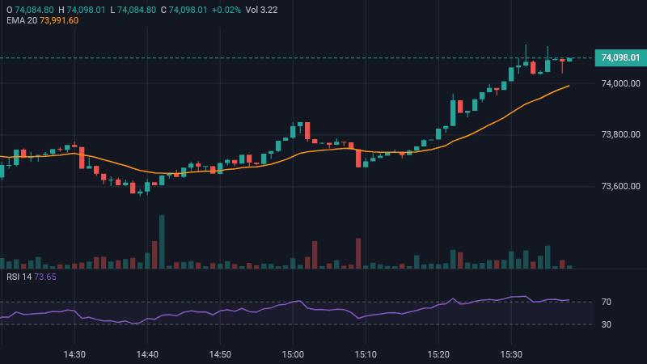
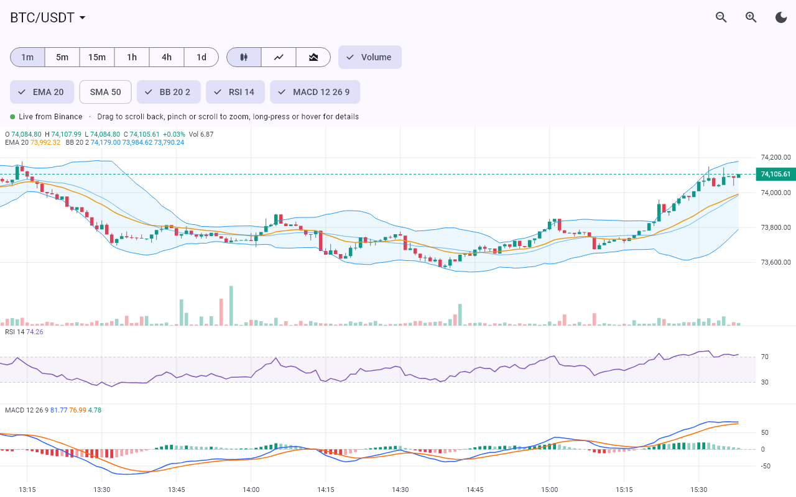

# market_chart

Free, open-source trading charts for Flutter. Candlesticks, line and area charts, volume, indicators, a crosshair, zoom and scrolling, and live price updates, with no licence key and no dependencies beyond Flutter.



## Features

- **Chart types:** candlesticks, line and area.
- **Volume** bars under the price.
- **Zoom and scroll:** drag to go back in time; pinch, trackpad-pinch or mouse wheel to zoom.
- **Crosshair:** long-press on touch screens or hover with a mouse. It snaps to the nearest candle and shows the price, time and an open/high/low/close summary.
- **Latest price** marked with a dashed line and a label.
- **Live updates that stay fast:** the chart works out what changed, so frequent updates stay cheap even with thousands of candles. It follows the latest candle, and keeps still if the user has scrolled back.
- **`CandleAggregator`:** turns a stream of trades or prices into candles of any length (5 seconds, 1 minute, 1 hour…).
- **Infinite history:** `onLoadMore` asks for older candles as the user scrolls back, without the view jumping.
- **`MarketChartController`:** jump back to the latest candle and zoom from your own buttons.
- **Indicators:** moving averages (SMA, EMA) and Bollinger Bands over the price; RSI and MACD in panels of their own. They stay up to date with live data, and their values are checked against TA-Lib.
- **Indicator maths on its own** too, for alerts or trading logic.
- **Clear axes:** time labels at round times (14:00, 14:15…) with dates where days start, and prices with as many decimals as the market uses.
- **Themes:** light and dark built in, every colour adjustable, and the app's font by default.
- Works on Android, iOS, web, Windows, macOS and Linux.

## Getting started

```yaml
dependencies:
  market_chart: ^0.2.0
```

```dart
import 'package:market_chart/market_chart.dart';

MarketChart(
  candles: [
    Candle(
      time: DateTime(2026, 11, 11, 9, 30),
      open: 64000,
      high: 64250,
      low: 63900,
      close: 64180,
      volume: 42.5,
    ),
    // ...oldest first
  ],
)
```

The chart fills the space it is given. Put it in an `Expanded` or a `SizedBox` with a height.

## Live prices

Rebuild the chart (for example with `setState`) whenever new data arrives. You can pass a new list or change the same list in place: the chart works out what changed.

- While the latest candle is in view, the chart follows new candles.
- After the user scrolls back, their view stays where it is.

### Feeds that send trades or prices

`CandleAggregator` builds candles for you. The first trade in a period starts a new candle; later ones move its close and stretch its high and low.

```dart
final feed = CandleAggregator(interval: const Duration(minutes: 1));

priceStream.listen((trade) {
  setState(() => feed.addTrade(trade.price, volume: trade.amount, time: trade.time));
});

MarketChart(candles: feed.candles)
```

Options:

- `fillGaps: true` adds flat candles for periods without trades, so the time axis has no jumps.
- `maxCandles` drops the oldest candles in charts that run for a long time.
- `origin` sets what periods line up with. The default (the Unix epoch, UTC) matches exchanges for intervals up to a day.

### Feeds that send candles

Exchange candle streams send the current candle again every time it changes. `addCandle` replaces a candle with the same time and adds newer ones:

```dart
final feed = CandleAggregator(
  interval: const Duration(minutes: 1),
  initialCandles: history,
);

candleStream.listen((candle) => setState(() => feed.addCandle(candle)));
```

### Back to the latest candle, and zoom buttons

```dart
final controller = MarketChartController(); // Dispose it in your State's dispose().

MarketChart(candles: feed.candles, controller: controller)

// Show a button only after the user scrolls back:
ListenableBuilder(
  listenable: controller,
  builder: (context, _) => controller.isAtLatest
      ? const SizedBox.shrink()
      : TextButton(onPressed: controller.jumpToLatest, child: const Text('Latest')),
)

IconButton(icon: const Icon(Icons.zoom_in), onPressed: controller.zoomIn)
```

### Loading older history

`onLoadMore` is called when the user scrolls near the oldest candle. Older candles you add don't move the view.

```dart
MarketChart(
  candles: feed.candles,
  onLoadMore: () async {
    final older = await api.fetchCandles(before: feed.candles.first.time);
    setState(() => feed.addHistory(older));
  },
)
```

While the returned Future is running, it isn't called again. After that, it's called again once older candles have been added, or when the user scrolls away and back.

### Prices from an exchange

Most exchanges offer candles over a REST API and live updates over a WebSocket. For example, with [Binance](https://www.binance.com)'s public market data (no account or API key needed), using the [http](https://pub.dev/packages/http) and [web_socket_channel](https://pub.dev/packages/web_socket_channel) packages:

```dart
// History from the REST API.
final response = await http.get(Uri.parse(
    'https://data-api.binance.vision/api/v3/klines?symbol=BTCUSDT&interval=1m&limit=500'));
final feed = CandleAggregator(
  interval: const Duration(minutes: 1),
  initialCandles: [
    for (final k in jsonDecode(response.body) as List)
      Candle(
        time: DateTime.fromMillisecondsSinceEpoch(k[0]),
        open: double.parse(k[1]),
        high: double.parse(k[2]),
        low: double.parse(k[3]),
        close: double.parse(k[4]),
        volume: double.parse(k[5]),
      ),
  ],
);

// Live candles from the WebSocket, about every 2 seconds.
final socket = WebSocketChannel.connect(
    Uri.parse('wss://data-stream.binance.vision/ws/btcusdt@kline_1m'));
socket.stream.listen((message) {
  final k = jsonDecode(message)['k'];
  setState(() => feed.addCandle(Candle(
        time: DateTime.fromMillisecondsSinceEpoch(k['t']),
        open: double.parse(k['o']),
        high: double.parse(k['h']),
        low: double.parse(k['l']),
        close: double.parse(k['c']),
        volume: double.parse(k['v']),
      )));
});
```

The [example app](example/lib/binance_feed.dart) adds what a real app needs: reconnecting when the connection drops (and fetching the candles it missed), older history as the user scrolls back, and Binance's trade stream so the price moves with every trade between candle updates. Binance isn't available in some countries, where it answers with HTTP 451.

## Indicators

```dart
MarketChart(
  candles: candles,
  indicators: const [
    MovingAverage.ema(20),
    MovingAverage.sma(50),
    BollingerBands(), // 20 periods, 2 standard deviations
    Rsi(), // 14 periods, levels at 70 and 30
    Macd(), // 12, 26, 9
  ],
)
```

- Moving averages and Bollinger Bands are drawn over the price, and the price scale stretches to fit them.
- RSI and MACD each get a panel below the price, in the order listed. Together the panels take at most 60% of the height, so the price always keeps room.
- The legends show each indicator's values for the candle under the crosshair, or for the latest candle.
- Values stay up to date as live data arrives, and only what changed is worked out again. The list is compared by value, so building it in every `build` is fine, and changing only a colour keeps the values.

Each indicator takes a `period`, a `source` (which price to use, for example `PriceSource.hlc3`), a `color` and a line `width`. `BollingerBands` also takes `deviations` and `fillOpacity`, `Rsi` takes `overbought` and `oversold` levels, and `Macd` takes `fastPeriod`, `slowPeriod`, `signalPeriod`, `macdColor` and `signalColor`. Moving averages and Bollinger Bands without a colour take the next one from `MarketChartTheme.indicatorColors`.

## Indicator maths

The maths behind the indicators is available on its own, for example for price alerts or trading logic.

```dart
final closes = candles.closes;

final sma20 = sma(closes, 20);
final ema20 = ema(closes, 20);
final bands = bollingerBands(closes); // 20 periods, 2 standard deviations
final rsi14 = rsi(closes); // 14 periods, Wilder's method
final result = macd(closes); // 12, 26, 9

print(bands.upper.last);
print(result.histogram.last);
```

Each result has one entry per candle. Entries are `null` until there is enough data, for example the first 19 of a 20-period average. To use another price, pass `candles.prices(PriceSource.hlc3)` (or `open`, `high`, `low`, `hl2`, `ohlc4`).

### Keeping indicators up to date

For live data, the calculators work out only what changed:

```dart
final rsi14 = RsiCalculator(period: 14)..update(closes);

// When the latest price changes or a new candle arrives:
rsi14.update(closes, from: closes.length - 1);
print(rsi14.values.last);
```

With 10,000 candles, all five indicators take about 7 ms to work out from scratch and about 5 microseconds to update after a new price (measured in a debug test run). Updating step by step gives exactly the same numbers as starting over.

### Accuracy

The results are checked against [TA-Lib](https://ta-lib.org) on 150 days of real BTC/USDT prices, and agree to within rounding (better than 0.000001). EMA, RSI and MACD start from simple averages, the standard method. Platforms that start them differently show slightly different values for roughly the first 50–100 candles, then agree.

## Options

| Property | Default | What it does |
|---|---|---|
| `type` | `MarketChartType.candles` | `candles`, `line` or `area` |
| `showVolume` | `true` | Volume bars under the price |
| `indicators` | `[]` | Indicators to draw (see above) |
| `controller` | | A `MarketChartController` for your own buttons |
| `theme` | matches app brightness | `MarketChartTheme.dark`, `.light`, or your own via `copyWith` |
| `pricePrecision` | from the data | Decimals shown in prices (by default as many as the prices have) |
| `timeFormatter` | `defaultTimeFormatter` | Labels for the time axis and crosshair |
| `initialCandleWidth` | `8` | Starting zoom, in pixels per candle |
| `minCandleWidth` / `maxCandleWidth` | `2` / `48` | Zoom limits |
| `onCrosshairChanged` | | Called with the candle under the crosshair, or `null` |
| `onLoadMore` | | Called when the user scrolls near the oldest candle |
| `loadMoreThreshold` | `20` | How near (in candles) before `onLoadMore` is called |

```dart
MarketChart(
  candles: candles,
  type: MarketChartType.area,
  theme: MarketChartTheme.dark.copyWith(lineColor: Colors.amber, fontFamily: 'Inter'),
  onCrosshairChanged: (candle) => setState(() => selected = candle),
)
```

## Example

The [example app](example) shows live prices from Binance. Pick a market (BTC, ETH, SOL, XRP or DOGE against USDT) and a timeframe from 1 minute to 1 day, switch indicators on and off, scroll back to load older history, and tap **Latest** to come back. If Binance can't be reached, it shows simulated prices instead.

```sh
cd example
flutter run
```



## Roadmap

- More indicators, such as VWAP, Stochastic and ATR.
- Custom indicators.
- Resizable indicator panels.
- Drawing tools such as trend lines.

Issues and pull requests are welcome.
